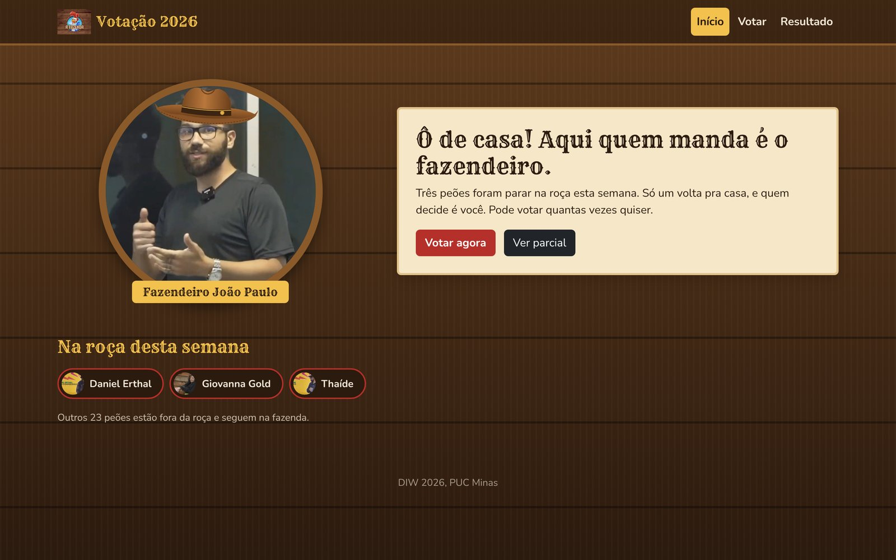
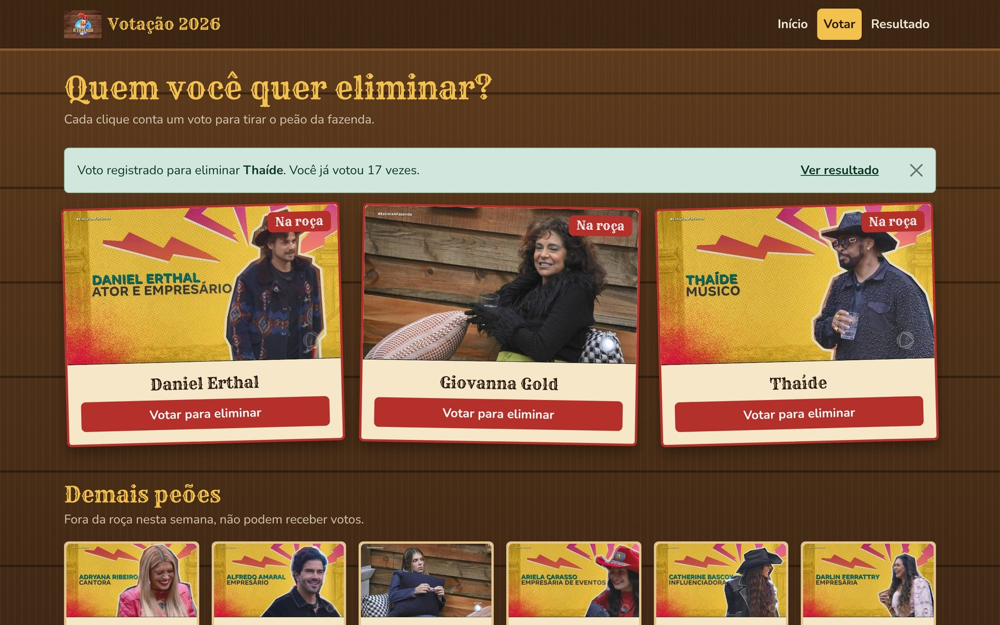
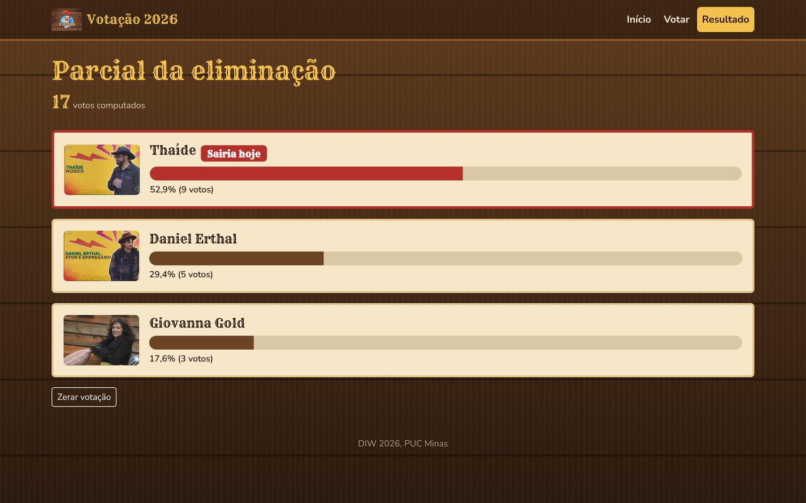
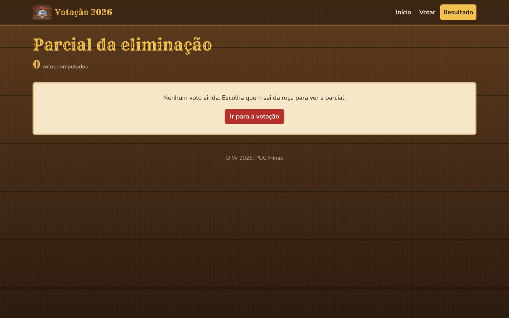

# Votação A Fazenda 2026

Aplicação web de votação de eliminação de A Fazenda 2026, desenvolvida para a AV2 da disciplina Desenvolvimento de Interfaces Web (DIW) do curso de Ciência da Computação da PUC Minas.

## Tecnologias

- HTML, CSS e JavaScript
- Bootstrap 5
- JSON Server
- Fetch API
- Fontes Rye e Nunito (licença SIL Open Font License)

## Funcionalidades

- Página inicial com o fazendeiro e os participantes que estão na roça
- Votação nos participantes da roça, com quantos votos o usuário quiser
- Parcial com o total de votos, a quantidade e o percentual de cada participante e destaque para quem sairia hoje
- Botão para zerar a votação, com confirmação em modal

## Estrutura

```
VotacaoFazenda/
├── package.json
├── db.json
├── docs/
│   └── prints/
└── public/
    ├── index.html
    ├── votacao.html
    ├── resultado.html
    ├── css/
    │   └── style.css
    ├── js/
    │   ├── api.js
    │   ├── index.js
    │   ├── votacao.js
    │   └── resultado.js
    ├── img/
    │   └── participantes/
    └── fonts/
```

## Como executar

É preciso ter o Node.js instalado.

1. Instale as dependências:

```
npm install
```

2. Inicie o servidor:

```
npm start
```

3. Abra no navegador:

```
http://localhost:3000/
```

## API

| Método | Rota | Descrição |
| --- | --- | --- |
| GET | /participantes?naRoca=true | Participantes que estão na roça |
| GET | /participantes?naRoca=false | Demais participantes |
| GET | /votos | Lista de votos |
| POST | /votos | Registra um voto (participanteId e data) |
| DELETE | /votos/:id | Apaga um voto |

## Telas

### Início



### Votação


### Voto registrado



### Resultado



### Resultado sem votos



## Autor

Thiago - Ciência da Computação, PUC Minas
